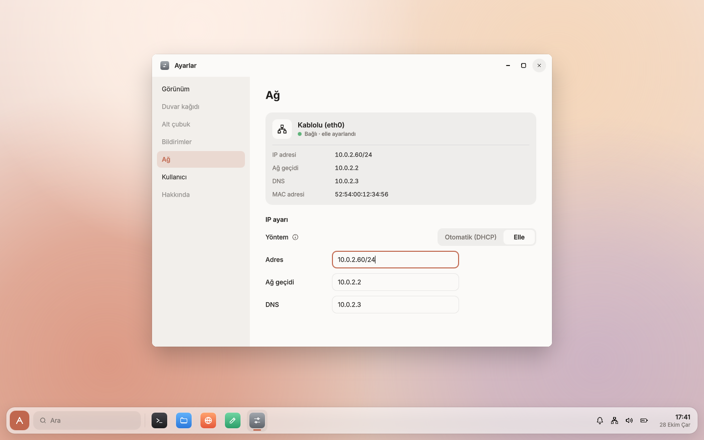

# Ağ

Kablolu ağı `ankaros-network` servisi yönetir. Neden kendi servisimiz: [karar 0011](kararlar/0011-ag-servisi.md).
Kod `system/network/` klasöründedir, C++20 ile yazılmıştır ve Qt kullanmaz.

- `eth0`'ı `/etc/ankaros/network.conf`'taki ayara göre açar:
  - DHCP: BusyBox'ın `udhcpc`'si çalışır. Adresi, rotayı ve `resolv.conf`'u BusyBox'ın varsayılan betiği
    ayarlar.
  - Statik: adres ve varsayılan rota `ip` ile, DNS `/etc/resolv.conf`'a yazılarak ayarlanır.
- Yerel arayüzü (`lo`) de açar.
- Durumu doğrudan çekirdekten okur:
  - kablo: `/sys/class/net/eth0/carrier`
  - adres: `getifaddrs`
  - ağ geçidi: `/proc/net/route`
  - DNS: `resolv.conf`
- Değişiklikleri netlink ile anında fark eder ve abonelere gönderir.

## network.conf

```ini
# mode: dhcp (adres ağdan otomatik alınır) ya da static (aşağıdaki değerler)
mode = static
address = 192.168.1.50/24
gateway = 192.168.1.1
dns = 1.1.1.1 9.9.9.9
```

- Dosya yoksa DHCP kullanılır. Geçersiz bir ayar günlüğe yazılır, yine DHCP kullanılır.
- `gateway` ve `dns` isteğe bağlıdır.
- Ayarlar › Ağ'dan değiştirilince dosya yeniden yazılır.

## Denetim soketi

`/run/ankaros/network.sock`. Protokol `system/common/protocol.h`'de.

| Komut | Kim gönderebilir | Ne yapar |
|---|---|---|
| `status` | herkes | Durumu döner (aşağıda) |
| `watch` | herkes | Durumu döner ve bağlantıyı açık tutar, durum her değiştiğinde yenisini gönderir |
| `set`, `dhcp` | root, `netdev` grubu | DHCP'ye geçer |
| `set`, `static`, adres, ağ geçidi, DNS | root, `netdev` grubu | Statik adrese geçer. DNS boşlukla ayrılmış adreslerdir. |

Durum satırları:

| Alan | Örnek |
|---|---|
| `interface` | `eth0` |
| `carrier` | `1` kablo takılı, `0` değil |
| `mac` | `52:54:00:12:34:56` |
| `mode` | `dhcp` ya da `static` |
| `address`, `gateway`, `dns` | o anki değerler, ör. `10.0.2.15/24` |
| `config.address`, `config.gateway`, `config.dns` | `network.conf`'taki statik değerler |

**Yetki:** Ayarı değiştirme yetkisi `netdev` grubundadır, `ankaros` kullanıcısı bu gruptadır
(`external/board/qemu-aarch64/users.txt`). Karar 0011'de "etkin oturumun kullanıcısı" yazıyor. Tek
kullanıcılı geliştirme imajında ikisi aynı sonucu verir. Grup ile denetlemek, ağ servisinin oturum
yöneticisine sormasını gerektirmez.

Seri konsolda denemek için:

```bash
ankarosctl network status
ankarosctl network set static 10.0.2.50/24 10.0.2.2 1.1.1.1
ankarosctl network set dhcp
```

## Arayüz

- **Alt çubuktaki ağ simgesi:**
  - Kablo takılı ve adres varsa tam renkli, değilse soluk.
  - Üzerine gelince durum balonda görünür ("Kablolu · 10.0.2.15", "Kablo takılı değil").
  - Tıklanınca Ayarlar › Ağ açılır.
- **Ayarlar › Ağ** (`NetworkSettings.qml`):
  - Bağlantı kartında durum, IP, ağ geçidi, DNS ve MAC görünür.
  - Yöntem Otomatik (DHCP) ya da Elle seçilir.
  - Elle'ye geçince alanlar o anki değerlerle dolar.
  - Uygula ve Vazgeç yalnızca bir şey değiştiğinde görünür. Hata ekranda gösterilir ("Adres 192.168.1.50/24 biçiminde olmalı").



Kabuk ağa `Desktop.network` nesnesi üzerinden ulaşır. ankaros'ta bu nesne compositor'daki C++ `Network`
sınıfıdır (Ankaros.System, `shell/qml/Ankaros/System/network.cpp`) ve `watch` ile abone olur, bağlantı koparsa yeniden bağlanır. Mac
önizlemesinde aynı modülün sahte `Network.qml`'i kullanılır (`ankaros-settings --page network`).

## Geliştirme

Ayar dosyası, adres doğrulama, `/proc/net/route` ve `resolv.conf` okuma birim testleriyle denenir
(`system/tests/network_test.cpp`). QEMU'da sanal ağ kablosu `qemu-test.py`'nin `link off` / `link on`
eylemiyle çıkarılıp takılabilir.

Wi-Fi Faz 4'te, gerçek donanımla birlikte gelecek.
