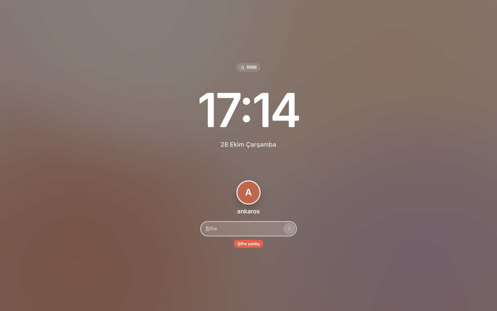
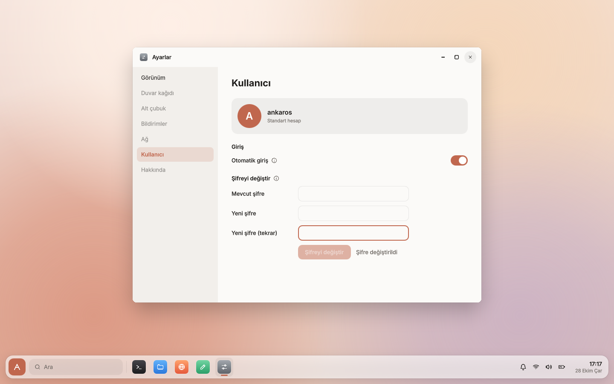

# Oturum yönetimi

Masaüstü root olarak değil, bir kullanıcı hesabıyla çalışır. Ekrandaki compositor'ı oturum yöneticisi
`ankaros-session` başlatır. Bu, ya giriş ekranıdır ya da giriş yapmış kullanıcının masaüstüdür. Neden
böyle tasarlandığı: [karar 0010](kararlar/0010-oturum-yonetimi.md).

```
ankaros-init
└── ankaros-session (root)                 şifreleri yalnızca bu süreç görür
    ├── ankaros-compositor --login         giriş ekranı, ankaros-login kullanıcısı
    └── ankaros-compositor                 masaüstü, giriş yapan kullanıcı (ör. ankaros)
```

## Hesaplar

| Kullanıcı | Şifre | Gruplar | Görevi |
|---|---|---|---|
| `ankaros` | `ankaros` | video, input, audio, users | Varsayılan kullanıcı |
| `ankaros-login` | yok, oturum açamaz | video, input | Giriş ekranını çalıştırır |
| `root` | yok | | Yalnızca seri konsoldan girilir (geliştirme ve kurtarma) |

- Hesaplar `external/board/qemu-aarch64/users.txt`'te tanımlıdır (Buildroot kullanıcı tablosu).
- Şifre derleme sırasında hash'lenir. Ayarlar › Kullanıcı'dan değiştirilebilir.
- `video` ekran kartına, `input` klavye ve fareye erişim içindir. udev aygıt dosyalarını bu gruplara verir.

## Akış

1. init, udev hazır olunca `ankaros-session` servisini başlatır.
2. `ankaros-session` `/etc/ankaros/session.conf`'a bakar. `autologin` bir kullanıcı adıysa o kullanıcının
   masaüstünü doğrudan açar, boşsa giriş ekranını açar. Otomatik giriş yalnızca açılışta uygulanır.
3. Giriş ekranı kullanıcı adını ve şifreyi `ankaros-session`'a gönderir. Şifre doğruysa giriş ekranı
   kapatılır ve kullanıcının masaüstü açılır. Ekranı (DRM) aynı anda tek bir compositor tutabildiği için
   ikisi hiçbir zaman aynı anda çalışmaz.
4. Oturum kapatılınca giriş ekranı yeniden açılır.
5. Masaüstü çökerse aynı kullanıcıyla yeniden açılır. 10 saniye içinde art arda 3 kez çökerse giriş
   ekranına dönülür.

Her oturum için `/run/user/<uid>` hazırlanır (`XDG_RUNTIME_DIR`). Wayland soketi oradadır. Ortamın geri
kalanı (eglfs/KMS, dil, klavye) `/etc/profile.d/ankaros-grafik.sh`'den gelir. Compositor'ın çıktısı
`/var/log/ankaros-compositor.log`'a, oturum yöneticisininki `/var/log/ankaros-session.log`'a yazılır.

## session.conf

```ini
# Açılışta şifre sorulmadan oturum açılacak kullanıcı. Boşsa giriş ekranı açılır.
autologin = ankaros
```

Geliştirme imajında otomatik giriş açıktır (`external/board/qemu-aarch64/rootfs-overlay/etc/ankaros/`).
Ayarlar › Kullanıcı'dan kapatılabilir.

## Denetim soketi

`/run/ankaros/session.sock`, protokol `system/common/protocol.h`'de. Bağlanan sürecin kullanıcısı
`SO_PEERCRED` ile öğrenilir. Her komutu yalnızca yetkili olan kullanıcı gönderebilir:

| Komut | Kim gönderebilir | Ne yapar |
|---|---|---|
| `status` | herkes | Ekrandakini (`greeter`, `session`), kullanıcıyı ve otomatik giriş ayarını döner |
| `login`, kullanıcı, şifre | giriş ekranı, root | Şifre doğruysa oturumu açar |
| `unlock`, şifre | oturumdaki kullanıcı | Kilit ekranı için şifreyi doğrular |
| `logout` | oturumdaki kullanıcı, root | Oturumu kapatır, giriş ekranına döner |
| `poweroff`, `reboot` | ekrandaki kullanıcı, root | init'e iletir |
| `autologin`, `on`/`off` | oturumdaki kullanıcı | `session.conf`'u yazar |
| `passwd`, eski, yeni | oturumdaki kullanıcı | Eski şifreyi doğrular, `/etc/shadow`'daki hash'i değiştirir |

- Hatalı şifreden sonra 1,5 saniye boyunca yeni deneme kabul edilmez.
- Yalnızca uid'si 1000 ve üstü olan kullanıcılar oturum açabilir. Sistem kullanıcıları açamaz.
- Hata mesajları ("Şifre yanlış") doğrudan ekranda gösterilecek biçimde Türkçedir.

Seri konsolda root olarak denemek için:

```bash
ankarosctl session status
ankarosctl session logout                 # giriş ekranına döner
ankarosctl session login ankaros ankaros  # giriş ekranındayken oturum açar
ankarosctl restart ankaros-session        # giriş ekranını ya da masaüstünü yeniden başlatır
```

## Arayüz

- **Giriş ekranı** (`LoginScreen.qml`): compositor `--login` ile açıldığında ekranın kendisidir. uid'si
  1000 ve üstü olan ilk kullanıcıyı gösterir. Sağ altta yeniden başlat ve kapat düğmeleri vardır.
  Giriş ekranı kullanıcının dosyalarını okuyamaz. Oturum yöneticisi bu kullanıcının temasını ve duvar
  kağıdını (`~/.config/ankaros/shell.conf`) okuyup `ANKAROS_DARK_MODE` ve `ANKAROS_WALLPAPER` ortam
  değişkenleriyle giriş ekranına verir. Ayarlar › Duvar kağıdı'nda "Kilit ve giriş ekranında da kullan"
  kapalıysa giriş ve kilit ekranında Ankara Taşı görünür.
- **Ölçek:** Oturum yöneticisi ekranın çözünürlüğünü DRM'den okur (`/sys/class/drm/*/modes`). 2560 piksel ve
  daha geniş ekranlarda (Retina, UTM'nin Retina modu) compositor'ı `QT_SCALE_FACTOR=2` ile başlatır.
  Compositor ölçeği Wayland çıktısıyla uygulamalara bildirir, uygulamalar pencerelerini 2 kat
  çözünürlükle çizer. Seçilen ölçek oturum yöneticisinin günlüğünde görünür ("ekran: 3680x2300, ölçek 2").
- **Kilit ekranı** (`LockScreen.qml`): Süper+L ya da başlat panelindeki güç menüsünden Kilitle. Masaüstünün
  kilitlendiği andaki görüntüsü bulanık arka plan olur, arkadaki uygulamaların değişen içeriği görünmez.
  Tıklamalar ve tuşlar uygulamalara ulaşmaz.
- **Güç menüsü** (`PowerMenu.qml`, başlat panelinin sağ altı): Kilitle, Oturumu kapat, Yeniden başlat,
  Kapat.
- **Ayarlar › Kullanıcı** (`UserSettings.qml`): otomatik giriş anahtarı ve şifre değiştirme.

| Kilit ekranı, hatalı şifre | Ayarlar › Kullanıcı |
|---|---|
|  |  |

Kabuk oturum işlemlerini `Desktop.session` nesnesi üzerinden yapar. ankaros'ta bu, compositor'daki
C++ `Session` sınıfıdır (Ankaros.System, `shell/qml/Ankaros/System/session.cpp`) ve denetim soketine bağlanır. Mac önizlemesinde
aynı modülün `Session.qml`'i aynı üyeleri sahte olarak karşılar (şifre `ankaros`).

## Geliştirme

Şifre hash'i, `/etc/shadow` güncellemesi ve `session.conf` birim testleriyle denenir
(`system/tests/session_test.cpp`). Akışın tamamı QEMU'da `qemu-test.py`'nin tuş ve tıklama eylemleriyle
denenir. Örnek: kilitle, yanlış şifre gir, ekran görüntüsü al:

```bash
./scripts/qemu-test.py --expect-desktop --actions \
  "key meta_l-l; sleep 10; type yanlis; key ret; sleep 10" --screenshot kilit.png
```

Arayüz Mac önizlemesinde de denenebilir: `--login`, `--lock` ve Ayarlar uygulaması `--page user`
([tasarim-akisi.md](tasarim-akisi.md)).
