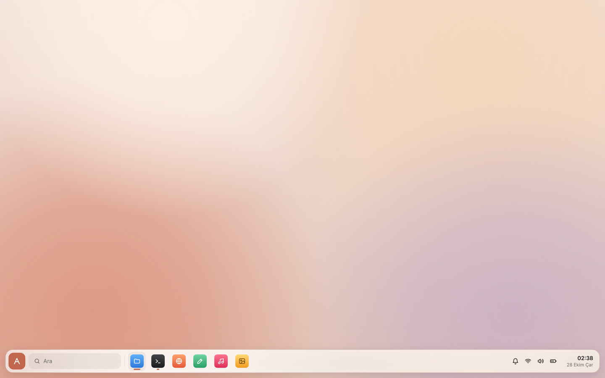
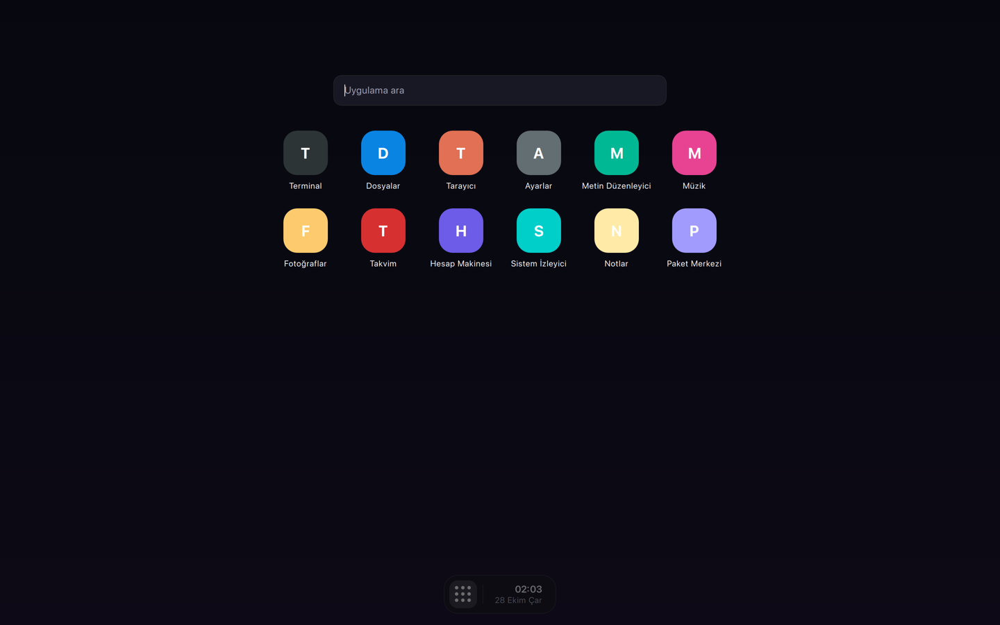
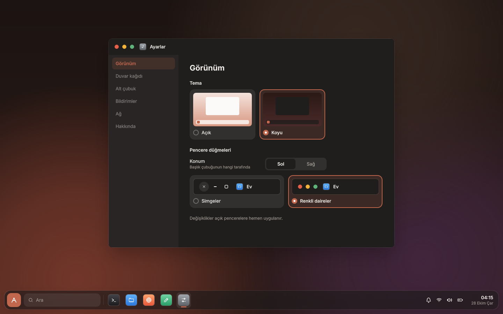

# Tasarım akışı: Figma'dan QML'e

Masaüstü Figma'da tasarlanır, `shell/` altında QML ile yazılır ve Mac önizlemesinde test edilir.
Son hali ankaros imajına paket olarak girer.

```
Figma (tasarım)  ──▶  Theme.qml + bileşenler  ──▶  Mac önizlemesi  ──▶  ankaros imajı
```

## 1. Figma dosyasının düzeni

Figma'daki yapı koddaki yapıyla eşleştiğinde aktarım çok kolaylaşır:

- **Değişkenler (Variables):** Renkler, boşluklar, köşe yarıçapları, yazı boyutları ve animasyon
  süreleri Figma değişkeni olarak tanımlanır. Her değişkenin `Theme.qml`'de aynı adla bir karşılığı vardır.
  Örnek: Figma'da `color/surface/panel` → QML'de `Theme.color.surfacePanel`.
- **Bileşenler (Components):** Panel, panel düğmesi, saat, başlatıcı kutucuğu gibi her parça bir Figma
  bileşeni olur. Her biri `shell/qml/Ankaros/Shell/` altında aynı adlı bir QML dosyasına karşılık gelir.
- **Çerçeve boyutu:** Masaüstü çerçeveleri **1440x900** boyutunda çizilir, önizleme penceresiyle aynı.
- **Açık/koyu mod:** Figma değişken modları (Light/Dark) olarak tanımlanır, `Theme.dark` ile değişir.

## 2. Tasarımı koda aktarmak

Figma'da bir ekran ya da bileşen hazır olduğunda bağlantısını (frame'e sağ tık → Copy link) Claude'a verin.
Claude, Figma bağlantısı üzerinden tasarımın ölçülerini, değişkenlerini ve görselini okuyup QML'e
aktarabilir. Bunun için Claude Code'da Figma bağlantısının açık ve yetkilendirilmiş olması gerekir.

Aktarma kuralları:

1. Önce değişkenler `Theme.qml`'e eklenir, sonra bileşenler yazılır.
2. Bileşenlerde değer doğrudan yazılmaz (`color: "#1e1e2e"` değil, `color: Theme.color.surfacePanel`).
3. Simgeler SVG olarak `shell/qml/Ankaros/Shell/icons/` altına aktarılır.
4. Animasyonlar Figma'daki Smart Animate süreleri ve eğrileri kullanılarak `Theme.motion` üzerinden yazılır.

## 3. Mac önizlemesinde test

```bash
./scripts/shell-preview.sh
```

Betik kabuğu derler (birkaç saniye) ve önizleme penceresini açar. Pencere Figma çerçevesiyle aynı
boyutta (1440x900) açılır, yeniden boyutlandırılabilir ve tam ekran yapılabilir. En küçük boyut
1024x720'dir. Figma ile karşılaştırmak için `--screenshot` ile alınan görüntüleri kullanın.

Önizleme penceresinde:

| Kısayol | Ne yapar |
|---|---|
| `Cmd+R` | QML'i yeniden yükler (C++ değişikliklerinde yeniden derleyin) |
| `Cmd+D` | Açık/koyu mod arasında geçiş yapar (Görünüm ayarlarına kaydedilir) |
| `Ctrl+Cmd+F` ya da `F11` | Tam ekran |
| `Cmd+Q` | Kapatır |

Geliştirici seçenekleri (Figma ile karşılaştırma ya da ekran görüntüsü için):

```bash
APP=build/shell/preview/ankaros-shell-preview.app/Contents/MacOS/ankaros-shell-preview
$APP --dark --launcher --screenshot ekran.png   # koyu mod, başlatıcı açık, görüntüyü kaydet ve çık
```

| Seçenek | Ne yapar |
|---|---|
| `--dark` | Koyu modda açar |
| `--launcher` | Başlat paneli açık olarak başlar |
| `--screenshot <dosya>` | Masaüstünün görüntüsünü PNG olarak kaydeder ve çıkar. Pencere boyutundan bağımsız olarak 1440x900 çizilir |
| `--size <GxY>` | Ekran görüntüsünün boyutu, ör. `--size 1024x720` |
| `--window` | Masaüstünde sahte bir uygulama penceresi gösterir (pencere tasarımı için) |
| `--settings` | Ayarlar penceresi açık olarak başlar (`--user` ile Kullanıcı sayfası) |
| `--login` | Giriş ekranını gösterir. Şifre: `ankaros` |
| `--lock` | Masaüstü kilitli başlar. Şifre: `ankaros` |
| `--error` | Giriş ekranı "Şifre yanlış" durumunda başlar |

Önizlemede oturum işlemlerini sahte bir oturum (`preview/FakeSession.qml`) karşılar, ankaros'ta
compositor'ın `Session` nesnesi.

## Şu anki tasarım: B · Ankara Taşı

Figma dosyası: [ankaros: Masaüstü Tasarımı](https://www.figma.com/design/i51xbYLOkRyD5Qc5PhgFDv).
Dört varyasyon çizildi (A Kehribar, B Ankara Taşı, C Bozkır, D Anka), **B seçildi**: ekranın altında
yüzen tek bir çubuk (başlat düğmesi, arama, uygulamalar, durum simgeleri, saat) ve ortada açılan bir
başlat paneli (arama, sabitlenmiş uygulamalar, önerilenler, kullanıcı).

| Açık mod | Koyu mod, başlat paneli açık |
|---|---|
|  |  |

Figma'daki masaüstü ekranında görünen Dosyalar penceresi kabuğun parçası değildir. Pencereler Faz 1'de
compositor'dan gelecek.

Bileşenler (`shell/qml/Ankaros/Shell/`):

| Dosya | Bileşen | Figma karşılığı |
|---|---|---|
| `Theme.qml` | Tüm tasarım değerleri (tekil nesne) | `Theme` ve `Vurgu` değişken koleksiyonları |
| `IconData.js` | Simge yolları ve uygulama simgesi renkleri | Bileşenler sayfası |
| `Label.qml` | Inter yazı tipli metin | |
| `Icon.qml` | Çizgi simge (Qt Shapes ile çizilir) | `Icon/*` |
| `AppIcon.qml` | Degrade uygulama simgesi | `AppIcon/*` |
| `GlassPanel.qml` | Arkasını bulanıklaştıran buzlu cam yüzey | panel dolgusu + arka plan bulanıklığı |
| `HoverButton.qml` | Üzerine gelince arka planı beliren düğme | `color/surface/hover`, `pressed` |
| `Wallpaper.qml` | Renk geçişi ve yumuşak renk lekeleri | Duvar kağıdı |
| `Desktop.qml` | Masaüstünün kökü. Önizleme ve compositor bunu yükler | Ekran çerçevesi |
| `TaskBar.qml`, `TaskItem.qml`, `Clock.qml` | Alt çubuk, uygulama öğesi, saat | Alt çubuk |
| `StartMenu.qml`, `AppTile.qml`, `RecommendedItem.qml` | Başlat paneli ve öğeleri | Başlat paneli |
| `WindowChrome.qml`, `WindowTitleBar.qml` | Pencere çerçevesi ve başlık çubuğu | `WindowTitleBar` bileşeni |
| `ShellSettings.qml` | Kalıcı kullanıcı ayarları (tekil nesne) | |
| `SettingsPanel.qml`, `SettingsPage.qml` | Ayarlar penceresi: kenar çubuğu ve sayfa düzeni | Ayarlar ekranları |
| `AppearanceSettings.qml` | Ayarlar › Görünüm | "B · Pencereler ve Ayarlar" sayfası |
| `UserSettings.qml` | Ayarlar › Kullanıcı | "Faz 2 · Oturum ve Ağ" sayfası |
| `SettingLabel.qml`, `InfoTip.qml`, `Bubble.qml` | Ayar adı, bilgi simgesi, açıklama balonu | `InfoTip` |
| `ToggleSwitch.qml`, `InputField.qml`, `PushButton.qml` | Anahtar, metin alanı, düğme | `Toggle`, `TextField`, `Button` |
| `SegmentedControl.qml`, `SectionTitle.qml` | Seçenek grubu (Sol/Sağ), bölüm başlığı | |
| `LoginScreen.qml`, `LockScreen.qml` | Giriş ve kilit ekranı | "Faz 2 · Oturum ve Ağ" sayfası |
| `PasswordField.qml`, `Avatar.qml`, `BigClock.qml`, `ErrorPill.qml` | Şifre alanı, avatar, büyük saat, hata balonu | `Şifre alanı`, `Oturum kartı` |
| `GlassIconButton.qml`, `LockBackground.qml` | Giriş ekranının cam düğmeleri, bulanık arka plan | |
| `PowerMenu.qml` | Başlat panelindeki güç menüsü | Güç menüsü |

### Tasarım ilkeleri

Bütün sistemde aynı tasarım dili kullanılır. Yeni bir ekran çizerken ya da QML'e aktarırken:

- **Sayfada açıklama yazısı olmaz.** Ayar satırının altına açıklama, sayfanın sonuna not yazılmaz. Bir
  ayarın açıklaması gerekiyorsa adının yanına bilgi simgesi (`InfoTip`) konur, açıklama üzerine gelince
  açılan balonda görünür. Kullanıcıyı ilgilendirmeyen bilgi (dosya yolları, "ileride gelecek" notları)
  balona da yazılmaz.
- **Ekranda yalnızca durum ve eylem metinleri vardır:** başlıklar, ayar adları, değerler ("Bağlı · DHCP"),
  düğmeler ve hata mesajları ("Şifre yanlış").
- **Ortalanan içerik otomatik yerleşimle ortalanır,** konum elle hesaplanmaz. Ortadaki bir öğenin yanına
  düğme eklenecekse düğme öğenin içine alınır (şifre alanındaki gönder düğmesi gibi), öğe kaymaz.
- **Aynı parça her ekranda aynıdır:** Ayarlar'ın kenar çubuğu, düğmeler, metin alanları, anahtarlar ve
  simgeler bileşenlerden gelir, ekrana özel kopyası çizilmez.
- **Simge düğmelerin adı balonda görünür,** düğmenin yanına yazılmaz (giriş ekranındaki güç düğmeleri
  gibi). Menülerde simge ve ad yan yana durur.

Faz 2'nin ekranları (giriş, kilit, güç menüsü, Ayarlar › Kullanıcı ve Ağ) Figma'da
"Faz 2 · Oturum ve Ağ" sayfasındadır. Bileşenleri "Bileşenler" sayfasındadır.

### Görünüm ayarları

Başlat panelindeki ayarlar düğmesi ya da alt çubuktaki Ayarlar, kabuğun kendi Ayarlar penceresini açar.
Görünüm bölümünde tema (açık/koyu), pencere düğmelerinin konumu (sol/sağ) ve stili (çizgi
simgeler/renkli daireler) seçilir. Değişiklik bütün açık pencerelere anında uygulanır ve
`ShellSettings` ile kalıcı olarak saklanır (karar 0007, 0008).



### Uygulama notları

- **Yazı tipi:** Inter 4.1 modülün içine gömülüdür (`fonts/`, SIL Open Font License). Böylece kabuk
  Mac'te ve ankaros'ta aynı görünür. Metinler için `Text` yerine `Label` kullanın.
- **Simgeler:** SVG dosyası yerine yol verisi olarak tutulur ve Qt Shapes ile GPU'da çizilir. Rengi
  temaya bağlanabilir ve Qt Svg modülüne ihtiyaç duyulmaz. Figma'ya yeni simge eklendiğinde yol
  verisi `IconData.js`'e eklenir (`<circle>`, `<rect>` gibi öğeler yola çevrilerek).
- **Buzlu cam:** `GlassPanel`, `backdrop` olarak verilen öğenin (duvar kağıdı) arkasında kalan
  bölümünü `MultiEffect` ile bulanıklaştırır. Faz 1'de backdrop, pencereleri de içeren sahne olacak.
- **Duvar kağıdı lekeleri:** Figma'daki bulanık elipsler yerine radyal degrade kullanılır. Görünüm
  aynıdır, çizim maliyeti çok düşüktür.

Yeni bir QML dosyası eklerken `shell/qml/Ankaros/Shell/CMakeLists.txt` içindeki `QML_FILES` listesine
de ekleyin.

## 4. ankaros'a almak

Faz 1'de `external/package/ankaros-shell` paketi `shell/` modülünü imaja derler. Mac'te çalışan QML
olduğu gibi kullanılır. Kabuk modülü Wayland'e özgü türleri import etmediği sürece (bkz.
[mimari.md](mimari.md)) iki ortam arasında kod farkı olmaz.
