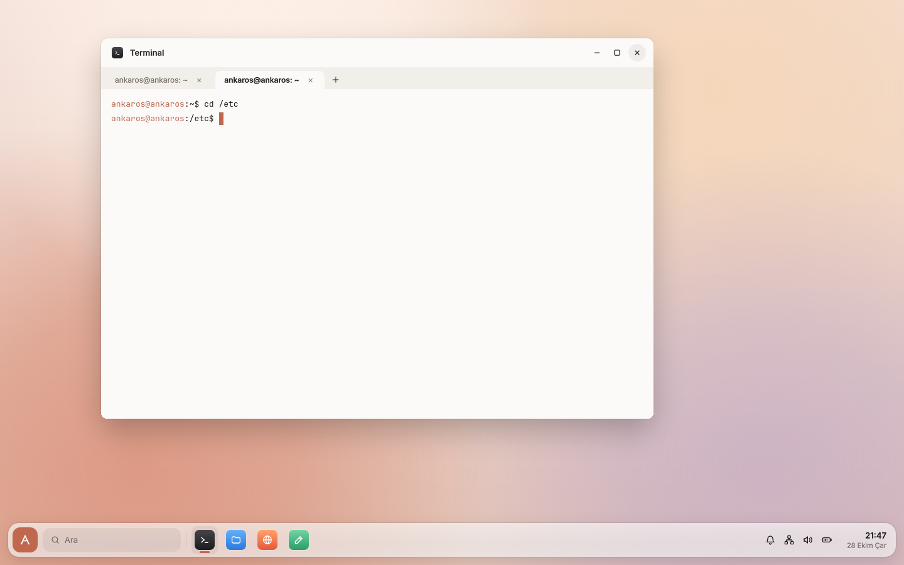
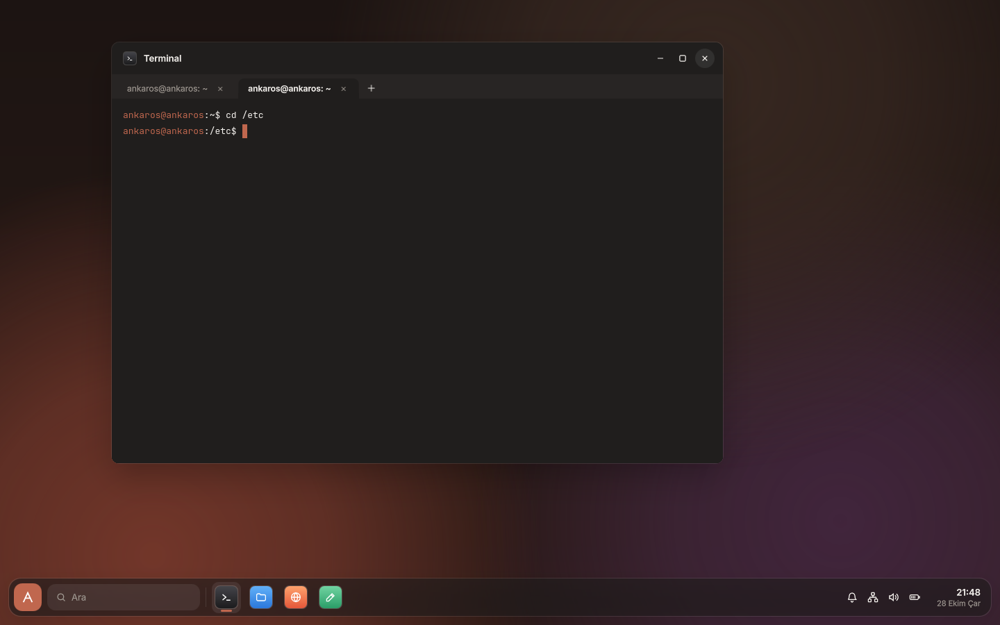

# Terminal

ankaros'un kendi terminali `ankaros-terminal`. Kodu `shell/apps/terminal/` klasöründe. Neden libvterm:
[karar 0014](kararlar/0014-terminal-libvterm.md). Tasarımı Figma'daki "Faz 3 · Uygulamalar" sayfasında
(Terminal, açık ve koyu).

| Açık tema | Koyu tema |
|---|---|
|  |  |

## Özellikler

- xterm öykünmesi (`TERM=xterm-256color`): 16, 256 ve 24 bit renk, kalın, italik, altı çizili, ters renk,
  geniş karakterler (漢), tam ekran uygulamalar (`vi`, `less`, `top`)
- Sekmeler. Sekmenin başlığı programın verdiği başlık, yoksa ev klasöründe `kullanıcı@makine: ~`, başka bir
  klasörde klasörün adı.
- Fareyle seçme (çift tıklama kelimeyi seçer), kopyalama ve yapıştırma. Pano compositor üzerinden diğer
  uygulamalarla paylaşılır. Kabuk istediyse yapıştırılan metin işaretlenir ("bracketed paste").
- 5000 satırlık kaydırma geçmişi (fare tekerleği, Shift+PageUp/PageDown)
- Yazı tipi JetBrains Mono (SIL OFL, uygulamaya gömülü). Boyutu Ctrl+artı/eksi ile değişir, saklanır
  (`~/.config/ankaros/ankaros-terminal.conf`).
- Renkler temayla birlikte değişir. İmleç ve seçim vurgu renginde.

## Kısayollar

| Kısayol | İşlem |
|---|---|
| Ctrl+Shift+T | Yeni sekme |
| Ctrl+Shift+W | Sekmeyi kapat (son sekmeyle pencere de kapanır) |
| Ctrl+Tab, Ctrl+PageDown / Ctrl+Shift+Tab, Ctrl+PageUp | Sonraki / önceki sekme |
| Ctrl+Shift+C / Ctrl+Shift+V | Kopyala / yapıştır (orta tuş da yapıştırır) |
| Ctrl+artı, Ctrl+eksi, Ctrl+0 | Yazı boyutu büyüt, küçült, varsayılana döndür |
| Shift+PageUp / Shift+PageDown | Geçmişte yukarı / aşağı |

Diğer bütün tuşlar (Ctrl+C, Ctrl+D, Ctrl+W...) kabuğa gider.

## Yapı

| Dosya | Görevi |
|---|---|
| `terminalscreen.cpp` (`TerminalScreen`) | libvterm'i sarar: kabuğun çıktısını yorumlar, görünen satırları ve geçmişi tutar, tuşları baytlara çevirir. Qt Quick'e bağlı değil, birim testleri bunu dener. |
| `ptyprocess.cpp` (`PtyProcess`) | Kullanıcının giriş kabuğunu sözde terminalde (`forkpty`) başlatır, çalışma klasörünü bulur |
| `terminalview.cpp` (`TerminalView`) | Bir sekme: ekranı çizer (`QQuickPaintedItem`), klavye, fare, seçim ve kaydırma |
| `Main.qml` | Pencere, sekme çubuğu, kısayollar, temaya göre renkler |

Ekran her değiştiğinde görünen satırlar QPainter ile çizilir. Aynı biçimdeki karakterler tek seferde
çizilir. Bu, yazılımsal çizimde (QEMU, softpipe) bile akıcı. Çok büyük çıktıda (ör. `cat` ile büyük bir
dosya) bir okumada en çok 256 KB işlenir, arayüz donmaz.

Kabuk istemi ve `ls` renkleri imajdaki `/etc/profile.d/ankaros-kabuk.sh`'tan gelir. Masaüstünde açılan
kabukta `QT_QPA_PLATFORM` Wayland kalır, oradan başlatılan Qt uygulamaları pencere olarak açılır.

## Geliştirme

```bash
cmake --build build/shell
ctest --test-dir build/shell                       # TerminalScreen'in birim testleri
build/shell/apps/terminal/ankaros-terminal.app/Contents/MacOS/ankaros-terminal   # Mac'te, zsh ile
```

Mac'te libvterm Homebrew'dan gelir (`brew install libvterm`), ankaros imajında BR2_EXTERNAL'daki
`libvterm` paketi derler (`external/package/libvterm`).
